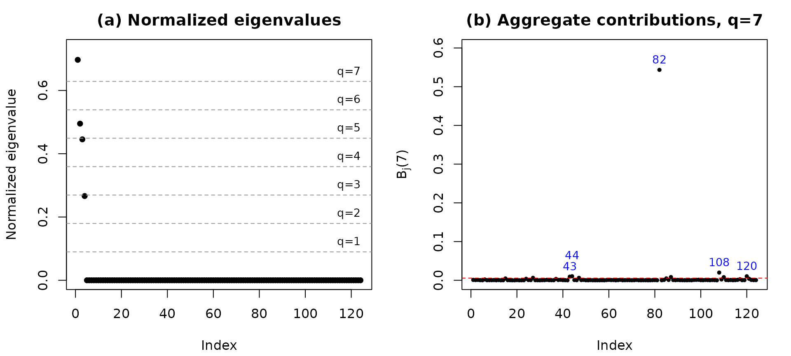
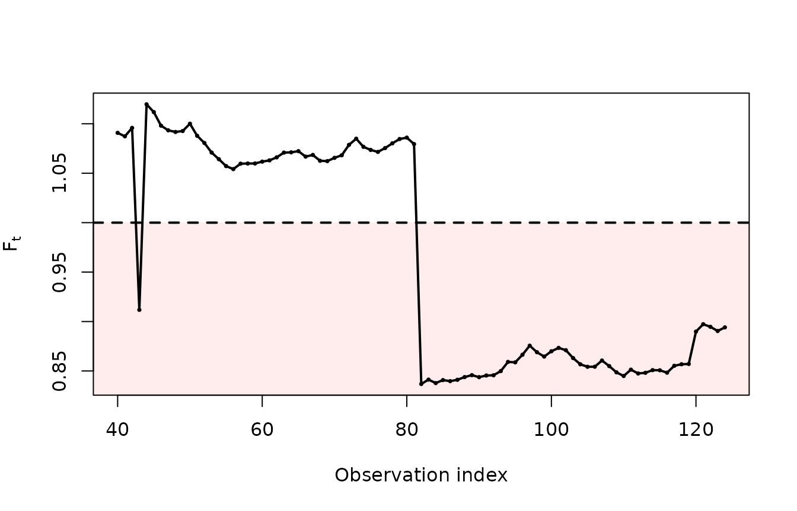
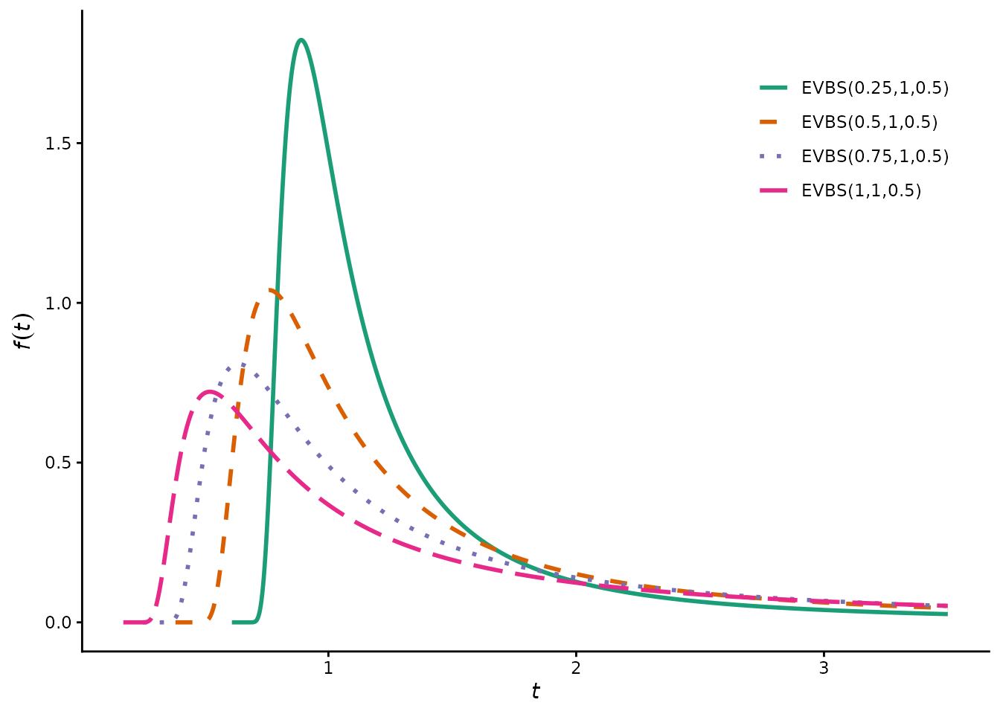

# Local influence diagnostics for the EVBS regression model

## Introduction

The **evbsreg** package implements local influence diagnostics for the
Extreme-Value Birnbaum–Saunders (EVBS) regression model. This vignette
walks through the complete workflow: fitting the model, diagnosing
influential observations, assessing model adequacy, and interpreting the
results, using the bundled Itajaí wind gust dataset. It then covers the
quantities that follow from a fitted model (finite upper endpoint,
return levels and expected shortfall), the prospective monitoring index,
and the same diagnostics under a generalized extreme-value (GEV)
regression.

Every result below is reproducible: the computations are deterministic
except the simulated envelope and the block bootstrap, which are run
after [`set.seed()`](https://rdrr.io/r/base/Random.html).

``` r

library(evbsreg)
```

## The data

The `itajai` dataset contains 124 monthly maximum wind gust speeds and
the corresponding daily mean atmospheric pressure, recorded at INMET
station A-868 in Itajaí, Brazil, from July 2010 to October 2020.

``` r

data(itajai)
str(itajai)
#> 'data.frame':    124 obs. of  3 variables:
#>  $ month   : int  1 2 3 4 5 6 7 8 9 10 ...
#>  $ wind    : num  11.7 16.4 10.5 17.2 11.2 12.3 14 17.1 13.7 14.8 ...
#>  $ pressure: num  1020 1013 1015 1009 1008 ...
summary(itajai$wind)
#>    Min. 1st Qu.  Median    Mean 3rd Qu.    Max. 
#>    8.20   12.15   14.30   14.73   17.02   33.90
```

Observation 82 is the catastrophic event of 26 April 2017 (33.9 m/s).

## Fitting the model

The design matrix must include an intercept column. We model the
location of the log-EVBS distribution as a linear function of
atmospheric pressure.

``` r

X <- cbind(1, itajai$pressure)
fit <- evbsreg.fit(X, itajai$wind)

data.frame(
  Parameter = c("beta0", "beta1", "alpha", "gamma"),
  Estimate  = round(fit$coeff, 4),
  SE        = round(c(fit$stderrors, fit$stderroralpha, fit$stderrorgama), 4)
)
#>   Parameter Estimate     SE
#> 1     beta0  25.5148 3.3338
#> 2     beta1  -0.0227 0.0033
#> 3     alpha   0.1857 0.0127
#> 4     gamma  -0.1551 0.0472
```

Both regression coefficients are highly significant:

``` r

round(fit$pvalues, 4)
#> x1 x2 
#>  0  0
```

## Local influence diagnostics

The
[`cnc_diagnostics()`](https://raydonal.github.io/evbsreg/reference/cnc_diagnostics.md)
function computes the conformal normal curvature diagnostics from the
fitted object.

``` r

diag <- cnc_diagnostics(fit)

## Top four normalized eigenvalues
round(head(diag$eigenvalues_norm, 4), 5)
#> [1] 0.69678 0.49511 0.44547 0.26630

## Observations flagged at q = 7
which(diag$Bj[7, ] > diag$bq[7])
#> [1]  27  43  44  47  82  87 108 110 120
```

The two-panel diagnostic figure shows the normalized eigenvalues (left)
and the aggregate contributions (right). Observation 82 dominates.

``` r

plot_cnc(diag, q = 7)
```



## Deletion analysis

We refit the model without the flagged observation and measure the
relative change in each parameter.

``` r

fit82 <- evbsreg.fit(X[-82, ], itajai$wind[-82])
rc <- 100 * (fit82$coeff - fit$coeff) / abs(fit$coeff)
names(rc) <- c("beta0", "beta1", "alpha", "gamma")
round(rc, 2)
#>  beta0  beta1  alpha  gamma 
#>  -3.24   3.64   0.25 -73.67
```

The tail-shape parameter $`\gamma`$ changes by -73.7%, while the
regression coefficients and the shape parameter $`\alpha`$ change by at
most 3.6%. The influence is therefore concentrated almost entirely on
the tail.

## Model adequacy

Randomized quantile residuals should be approximately standard normal
under a correct specification. For a continuous response they are
deterministic, $`r_i = \Phi^{-1}\{\hat F(t_i)\}`$.

``` r

r <- rqrandomized(X, itajai$wind)
shapiro.test(r)
#> 
#>  Shapiro-Wilk normality test
#> 
#> data:  r
#> W = 0.98727, p-value = 0.3021
```

The simulated envelope is random, so fix the seed to reproduce it.

``` r

set.seed(2023)
envelope_qq(X, itajai$wind, nrep = 100)
```


## Endpoint, return levels and expected shortfall

When $`\hat\gamma < 0`$ the fitted EVBS distribution has a finite upper
endpoint, which depends on the covariate through the linear predictor
$`\eta = x^\top\beta`$. At the covariate value of observation 82:

``` r

eta82 <- sum(X[82, ] * fit$betahat)
c(endpoint = unname(evbs_endpoint(eta82, fit$alphahat, fit$gamahat)),
  observed = itajai$wind[82])
#> endpoint observed 
#> 47.76947 33.90000
```

Return levels come from the exact quantile function
[`qevbs()`](https://raydonal.github.io/evbsreg/reference/qevbs.md). With
monthly maxima, `period` is in months, so `12 * 50` is the level
exceeded on average once every 50 years (at the given covariate value,
here the mean pressure):

``` r

evbs_return_level(fit, x = c(1, mean(itajai$pressure)),
                  period = 12 * 50, es = TRUE)
#>       return_level expected_shortfall 
#>           27.60566           29.20929
## 10-, 50- and 100-year levels at the same covariate value
qevbs(1 - 1 / (12 * c(10, 50, 100)),
      eta = sum(c(1, mean(itajai$pressure)) * fit$betahat),
      alpha = fit$alphahat, gama = fit$gamahat)
#> [1] 24.50267 27.60566 28.79564
```

Note that $`\exp(x^\top\hat\beta)`$ is a scale, not the conditional
median; conditional quantiles always come from
[`qevbs()`](https://raydonal.github.io/evbsreg/reference/qevbs.md).

## Standard errors under serial dependence

If the residuals show serial dependence, moving-block bootstrap standard
errors are a safer guide than the information-based ones:

``` r

set.seed(2023)
bb <- evbs_block_boot(X, itajai$wind, L = 4, B = 100)
round(bb$se, 4)
#>  beta0  beta1  alpha   gama 
#> 3.5717 0.0035 0.0121 0.0836
```

## Prospective monitoring

[`evbs_monitor()`](https://raydonal.github.io/evbsreg/reference/evbs_monitor.md)
refits the model at each instant after a burn-in, finds the observation
flagged by the curvature diagnostic, and compares it with the fitted
upper endpoint. Values of the index $`F_t`$ below one mean that the
flagged observation is close to or beyond what the model can
accommodate.

``` r

ct <- evbs_monitor(X, itajai$wind, burn = 40)
ct[ct$F < 1, c("t", "flagged", "gama", "endpoint", "F")][1:4, ]
#>     t flagged       gama endpoint         F
#> 4  43      43 -0.3025987 19.78611 0.9118021
#> 43 82      82 -0.1413614 28.36888 0.8368401
#> 44 83      82 -0.1359969 28.51878 0.8412620
#> 45 84      82 -0.1376183 28.39953 0.8377442
plot(ct)
```



Apart from a single dip at $`t = 43`$, the index stays above one until
the April 2017 event enters the sample at $`t = 82`$, and stays below
one from then on. Setting `use = "max"` gives the naive version that
always deletes the sample maximum instead of the observation flagged by
the curvature.

## Comparison with GEV regression

The same diagnostics are available for a GEV regression fitted to the
response scale. Centre the covariates first: the GEV likelihood is
poorly conditioned otherwise.

``` r

Xc <- cbind(1, itajai$pressure - mean(itajai$pressure))
gfit <- gevreg.fit(Xc, itajai$wind)
gfit$convergence
#> [1] 0
gdiag <- cnc_diagnostics_gev(gfit)
```

To compare influence rankings, use the same statistic for both families:
`colMeans(diag$Bj)` for the EVBS fit and `Bbar` for the GEV fit.

``` r

Bbar_evbs <- colMeans(diag$Bj)
head(order(Bbar_evbs, decreasing = TRUE), 3)
#> [1]  82 108   6
head(order(gdiag$Bbar, decreasing = TRUE), 3)
#> [1]  82   6 108
cor(Bbar_evbs, gdiag$Bbar, method = "spearman")
#> [1] 0.9450071
```

The prospective index under the GEV model is
`gev_monitor(Xc, itajai$wind)`.

## Density shapes

The package also provides the density-plotting functions used for the
density figures of the paper.

``` r

plot_evbs_alpha()
```



## Reproducing the full study

Five standalone scripts reproduce the density figures, the Itajaí
application and the Monte Carlo study. They write only to
[`tempdir()`](https://rdrr.io/r/base/tempfile.html). After installation
they are available via
[`system.file()`](https://rdrr.io/r/base/system.file.html):

``` r

# Density figures
source(system.file("scripts/script_01_density_figures.R", package = "evbsreg"))

# Itajai application
source(system.file("scripts/script_02_itajai_application.R", package = "evbsreg"))

# Monte Carlo study; set m <- 500 inside for a quick check
source(system.file("scripts/script_03_simulation_scenario1.R", package = "evbsreg"))
source(system.file("scripts/script_04_simulation_scenario2.R", package = "evbsreg"))
source(system.file("scripts/script_05_simulation_scenario3.R", package = "evbsreg"))
```

## References

Ferreira, M., Gomes, M. I., and Leiva, V. (2012). On an extreme value
version of the Birnbaum–Saunders distribution. *REVSTAT*, 10, 181–210.

Ospina, R., Lima, J. I. C., Barros, M., and Macêdo, A. M. S. (2026).
*Local influence diagnostics for extreme-value Birnbaum–Saunders
regression, with an application to wind-gust extremes.* Submitted.
